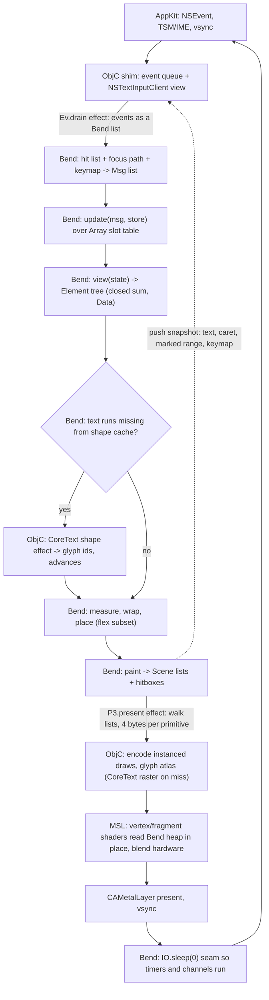

### Verdict

Yes, it is viable, but as a GPUI-inspired reimplementation, not a port or a fork. Bend 2 can express the framework core without `@unsafe`: the element tree, flex layout, text wrapping, hit testing, message dispatch and the entity store. That core measured 0.17 to 2.15 ms per frame for trees of 500 to 5,000 elements. The most credible path is **P3**. It has three parts:
- the Bend core;
- one Objective-C effect file for the window, input, IME, clipboard and CoreText;
- a small Metal render pipeline that draws the Bend-built Scene by reading it straight out of the Bend heap.

The P3 prototype draws a frame of 256 cards and 2,000 glyphs in 0.42-0.47 ms at 1920x1200 and in 0.62-0.71 ms at 3024x1964. In a real Retina window it held 120 Hz with no missed frames.

"Fully written in Bend" can honestly mean about 82% of the macOS framework, counted in zui-equivalent lines. The rest, about 15k zui-equivalent lines, is the platform layer plus pixel shading, in Objective-C and MSL. It cannot mean Bend only. Native code enters a Bend program only through `.c`/`.js` effect files, and having Bend shade the pixels too (87% Bend, path P2) costs 16-39x more per frame and drops to 60 Hz on a full Retina redraw. It also cannot be a "fork" in zui's sense: no GPUI patch applies to Bend source, so the project would follow GPUI's design by hand.

### Overview

**zui** (zeronsh/zui at 667d0aa) is a one-shot verbatim extraction of Zed's GPUI: 152,848 lines of Rust and 4,530 lines of shaders, in a single squashed commit with no shared git history. "Standalone, not a fork" works for zui only because it is the same Rust source with Zed's crate paths kept, so `git format-patch | git apply` still carries upstream fixes across. By zui-equivalent lines, the framework logic a Bend version would rewrite is about 67k lines (gpui/src minus its test harness, plus scheduler, sum_tree, refineable and the small utility crates). The macOS platform layer is another 14k lines: about 10.5k of glue, 3.3k of Metal renderer and atlas, and 1.4k of MSL.

**Bend 2** (bendlang/bend at 565d7fd, version 2.0.35, unchanged upstream as of today) compiles a program to one C file. Pure code runs on a CPU thread pool, and code marked `!` runs on the GPU as a single compute kernel. Native code is reachable only through foreign effect files run by the event loop. Base's window takes a pixel quadtree (`Image`) and returns a batch of events. The project is 17 days past 2.0.0 with 35 point releases, and its README says the compiler is "99% AI-written".

**The core tension.** GPUI's control is inverted: AppKit owns the loop and calls stored closures (`Rc<dyn Fn>` listeners, five platform trait objects, synchronous IME queries). Bend owns its loop, pulls events once per frame, and has affine closures, closed sum types and no traits. Every design choice below follows from that mismatch.

**Prior art.** Nobody has reimplemented GPUI in another language. gpuix (napi plus wasm-bindgen over a forked GPUI), gpui-moonbit (a Rust staticlib with a cbindgen header) and gpui-react (Bun FFI) all bind native GPUI. backplane-bend shows that a large Bend UI app is possible. It has 17.7k Bend lines of UI, written in 8 days by two authors with Claude co-authoring 132 of 229 commits. But it is an app, not a framework, it is X11 only, it renders on the CPU, and it no longer type-checks under Bend 2.0.35.

**Reading of the request.** gpuix means "GPUI for language X", and the user also says "whose code is Bend" and "not a git fork, the same way zui is not". So the target is a rewrite (P2/P3). The binding shape (P4/P5) exists and is cheap, but none of GPUI's code would be Bend.

**Test conditions.** All measurements are from an Apple M3 Pro under sustained external load: load average 3-12, and 35-65% GPU utilization from other processes. Treat GPU-lane numbers as upper bounds.

### Key Concepts

- **GPUI frame.** Elements are rebuilt every frame and go through three phases. `request_layout` uses taffy, with a boxed measure closure for text. `prepaint` registers hitboxes and dispatch-tree nodes. `paint` fills the `Scene` with primitives and registers listeners for the next frame. The `Scene` is per-kind `Vec`s of `#[repr(C)]` primitives, which `MetalRenderer::draw_frame` encodes as instanced draws. Durable state lives in `Entity<T>`, which is updated through a take-and-reinsert lease (`EntityMap::lease`/`end_lease`).
- **Affine closures.** A Bend closure can be called at most once (`guide/GUIDE.md:83-85`). A closure field makes a type `Type`, never `Data`. GPUI listeners are shared and called many times (`div.rs:575-582` pushes `Rc::new(...)`), so in Bend they become **defunctionalized `Msg` data**, interpreted by one `update(msg, store)`.
- **`Data` vs `Type`, and `+`.** `Data` values can be shared with `+`, at a refcount cost (an atomic per read on the GPU). `Type` values have exactly one owner. A tree containing any closure turns into `Type` and can no longer be shared across the measure, place and hit passes.
- **Effects.** A foreign def's body is `import "./x.c"` and/or `import "./x.js"`, and it must return base `IO`. Only the event loop runs effects. Effects that need nothing to wait on (need 0) run inline in `io_step` and loop without yielding, which starves timers until something parks.
- **`!` (bang).** Offloads a call to the GPU only when it is the root task of an IO-step evaluation. A bang that comes after a host fork in the same evaluation runs on the CPU. The bang mark belongs to the **def**, not the call site. Device code is one compute kernel, `bend_dev`, with no vertex/fragment pipeline, texture sampler or blend unit. Its speed depends on how many GPU lanes the fork tree keeps busy (lane occupancy).
- **Handle laws.** `Window`, `File`, `Socket` and `Audio` are opaque linear handles that only Base may define (WONTFIX #825). A custom effect reuses `Window` and reaches the `NSWindow`/`CAMetalLayer` through `io_hand_v`. Alternatively it wraps a C-side id in a user `Type` record, which stays affine but can be forged.
- **In-place Scene read (P3).** The C effect walks the Bend Scene lists once and records only each node's heap word offset, 4 bytes per primitive. The shaders then read every field directly from the Bend heap, which is wrapped as a no-copy `MTLBuffer`.
- **IME snapshot.** Each frame, Bend pushes `{text, caret, marked range}` to an Objective-C `NSTextInputClient` view. That view answers AppKit's synchronous queries from its local copy, applies edits optimistically, and queues them for Bend to drain after the frame.
- **Damage tracking.** Keep the previous frame's `Image` quadtree and re-rasterize only the cells that touch a dirty rectangle. Bend-side rasterization needs this at Retina. P3 does not.

### How It Works

One frame of the recommended P3 design, from OS event to pixels:

1. **OS event (native).** AppKit delivers an `NSEvent`.
   - GPUI turns it into `PlatformInput` in `handle_view_event` (`gpui_macos/src/window.rs:2605`) and calls a stored closure right away.
   - Bend never calls `[NSApp run]`. Base pumps Cocoa only inside `Window.frame` (`effs/window.c:408-423`). In P3 the present effect pumps events itself, as `p3_go` does at `p3fx.c:267-272`.
   - The shim queues events. Typed text comes through `interpretKeyEvents` into an `NSTextInputClient` that Bend owns. Base's own key codes lose case, Option characters and IME (Shift+a and Cmd+a both arrive as 97).
   - Two ways to attach that view were verified: an overlay subview that becomes first responder, or an Objective-C category on Base's `BendView`.
2. **Drain (effect).** After presenting, Bend calls a drain effect that returns the queued events as a Bend list. This is GPUI's control flow reversed: GPUI is called by the OS, Bend polls once per frame.
3. **Dispatch (Bend).** Mouse events are hit-tested against last frame's hitbox list. Key events walk the focus path and the keymap, keeping multi-stroke pending state in Bend.
   - GPUI runs every paint-registered mouse closure for every event (`window.rs:5202-5258`). In Bend each hitbox carries a `Maybe<Msg>` instead.
   - Synchronous OS questions are answered from data pushed the frame before:
     - "Did a binding handle this key?" needs either a pushed keymap or a one-frame redispatch. GPUI asks this synchronously in `handle_key_event`, `gpui_macos/src/window.rs:2464-2603`.
     - `windowShouldClose` is answered the same way.
   - If pushed data is not enough, the `corpus_eval` re-entry hack can run Bend synchronously inside AppKit's callback stack. It survived 20,000 calls, forks and 301 GPU bangs, but it uses internals with no ABI promise.
4. **Update (Bend).** `update(msg, store)` rewrites the state.
   - Entities are U32 ids into a Base `Array<Ent>` used as a slot table, threaded linearly through `view`. Sparse keys use a roughly 60-line U32 trie.
   - There is no `Rc` and no `Drop`, so handles are not released automatically. Use explicit `release(id)` or a per-frame sweep from window roots.
   - GPUI's lease pattern maps directly, because Bend's ownership model already is take-then-reinsert.
   - Signed quantities such as `DevicePixels: i32` and `tab_index: isize` become F32 or two's-complement U32 with hand-written signed helpers. Bend has no U64 or F64, and Nat ids fail-stop above 2^48-1.
5. **View (Bend).** `view(state)` builds a closed-sum `Data` tree (`Div | Text | Img | List | UniformList | Button ...`).
   - There are no traits, so `AnyElement`, `dyn Action` and `TypeId` matching become constructor tags. A user-defined element means adding an arm, or using a `Custom{kind, data}` escape hatch.
   - There are no macros, so the roughly 114 Tailwind-style style methods are written by hand or generated as Bend source.
   - Recursion over the tree is "forest recursion" (`case K{.., kids} <> t:`), because mutual recursion needs `@unsafe`.
6. **Text (effect, then Bend).** GPUI calls CoreText synchronously from taffy's measure closure. Bend cannot, because shaping is IO and layout is pure. So the frame is staged:
   - collect the text runs missing from the shape cache;
   - shape them in one CoreText effect;
   - then lay out purely.

   The measured round trip is 0.36 ms for a 2,000-character block, or about 10 µs per changed 80-character line. Strings are cons lists of characters, so the shape cache is keyed per line.
7. **Layout (Bend).** A bottom-up measure pass, a greedy word wrap over cached advances, then a top-down place pass. The prototype covers row/column, padding, gap, flex-grow, justify, align and stretch. GPUI's `Style` also has grid and block layout (`style.rs:170-328`, `770`), so "a flex subset replacing taffy" understates the eventual layout engine.
8. **Paint (Bend).** Emit a flat Scene (quad list plus glyph-sprite list), the hitbox list and the IME snapshot.
   - The whole core (view, layout, paint and hit test) costs 0.171 / 0.803 / 2.15 ms for 501 / 2,001 / 5,001 elements.
   - It runs on one core. List recursion does not parallelize, and 1 thread and 12 threads give the same time.
   - It must stay off the `!` lane: `layout!` took 14.4 ms at 501 elements and crashed with a machine stack overflow at 2,001.
9. **Present (native).** `P3.present(win, qs, gs)` walks the two lists, which takes 8-12 µs and records 4 bytes per primitive, and encodes two instanced draws. The fragment shaders compute the rounded-rect SDF and border from fields read in place, and blend premultiplied-over in hardware.
   - The effect takes the lists as `IO(Window & Qs & Gs)` and hands them back. Bend's affine typing therefore keeps the Scene alive while the GPU reads it.
   - A production version would keep the glyph atlas texture on the C side (CoreText rasterizes on a miss, as GPUI's `paint_glyph` does) and put tile ids in the Scene. Keeping texels in a shared Bend tree cost 4x at 2x resolution, because of refcount traffic.
10. **Yield (Bend).** End each frame with `IO.sleep(0)`. Present effects run inline with need 0, so a loop that never parks starves timers and channels for the whole run.
    - Skip `App.run`. It adds an `Image.drop!` bang every frame (`base.bend:2954`).
    - Without it, the binary has `BANGS 0`: it builds with clang 14+, ships no `.gpu` archive, and avoids the mixed-mode tax (17-19 ms vs 10-11 ms per frame) and the per-def bang trap.

### Paths compared

| Path | What is Bend | What is not | Frame cost | Blockers | Effort (estimate) | Fit with "fully Bend" |
|---|---|---|---|---|---|---|
| P1: stock Base (`App.run`, `Image`) | Everything except Base's `window.c` | Base `window.c` | Measured: 8.3 ms vsync-capped for 256 cards + 2,000 glyphs in a real 1x window (3x120 frames). Adding the core (0.8-2.3 ms) breaks 120 Hz at 2k+ elements (estimate from the measured parts) | Fixed size, 1x only, no typed text or IME, 24-bit color with alpha forced to 1, no real fonts | 2-4 weeks for a demo; parity impossible | 100% Bend, but a toy |
| P2-CPU: Bend core + ObjC shim + Bend rasterizer on the CPU pool | Core plus rasterizer and atlas | Shim (window, input, IME, CoreText, clipboard) | Measured: 1x full redraw 7.5-8.3 ms (5x30). 2x full redraw 15.1-15.4 ms headless and 16.9 ms in a real window, 100% of frames over 12.5 ms (3x115). 2x with damage tracking, small damage: 8.33-8.38 ms (1-4% missed). Scrolling a text column with safe glyph storage: 24.9 ms | Needs damage tracking (a retained image) at Retina. Full-screen changes run at 60 Hz or lower. No blur, alpha or MSAA paths in a 24-bit quadtree | P3 effort plus Bend raster and damage machinery | About 87% by zui-equivalent lines |
| P2-GPU: same, rasterizer on `!` with host binning | Same as P2-CPU | Same | Measured: 1x 7.84 ms at 256 cards, 8.58 ms at 1,024 (5x30), 16-31 ms on sparse frames. 2x 24-101 ms. Incremental update on `!` 52-106 ms | Lane under-occupation on sparse UI trees. Needs a custom loop with an IO seam. Idle gaps slow it 3-4x | As P2-CPU | About 87% |
| **P3 (recommended): Bend core + ObjC shim + small MSL raster pipeline reading the Bend heap** | Core, Scene, IME state, shape cache | Shim plus about 60 lines of MSL now (zui's full renderer is 2,862 + 399 + 1,377 lines) | Measured, renderer only: 0.42-0.47 ms at 1920x1200 and 0.62-0.71 ms at 3024x1964 (3x97). Real 2x window: 8.26 ms vsync-locked, 0% over 12.5 ms (3x115). Estimated total with a 5k-element core: about 3 ms | Shaders hard-code Bend's heap node layout (no ABI promise). macOS only (no Vulkan, #811). In-window GPU time 2.55 ms vs 0.34 ms headless, unexplained | Demo subset 4-10 weeks. Usable macOS subset 4-8 months. GPUI parity person-years | About 82% by zui-equivalent lines. MSL shades the pixels |
| P4: Bend bindings over native zui | App model, update, view emitting a mutation batch | All of zui (301-crate closure) plus a Rust C-ABI shim | Native GPUI (not measured) plus marshalling | `MacPlatform::run` blocks even headless. Embedding needs a patched `gpui_macos` (gpuix's fork has `new_embedded`/`pump_events`). No host-to-Bend calls (#813) | 1-3 months to a demo | Framework is 0% Bend |
| P5: Bend `.mjs` module driving `@gpuix/native` from JS | Pure model, update, view | JS host, gpuix, forked GPUI | Not measured. JS lane is sequential, one core | Lists cross as `{$:'Con',...}` objects. Host language is JS | Days (foldkit-native, created today, does the same for an Elm-style TS framework) | 0%. An API spike only |

**Recommendation: P3.**
- **Speed.** It is the only path measured to hold 120 Hz at 2x with full redraws. On the same 256-card scene it is about 16-20x faster than the best P2 variant at 1x and 23-39x faster at 2x. That removes the need for damage tracking, which is the hardest piece of P2.
- **Visuals.** Alpha, hardware blending and antialiased SDF edges come for free. Blur and MSAA paths can be ported from zui's `metal_renderer.rs` and `shaders.metal`, which a quadtree `Image` cannot express.
- **No `!`.** It needs no bang anywhere, which sidesteps all of the measured `!` traps.
- **Cost.** It is probably not more work than P2. The renderer prototype is 349 lines of C including the MSL, while P2 needs a Bend rasterizer, a glyph atlas in Bend and a damage-tracking image design.
- **Honesty.** The pixels are shaded by MSL, not Bend.
- **Keep the Bend rasterizer as a fallback.** Use P2-CPU with damage tracking where Metal is absent, for example Linux on X11 following backplane's effect. Windows is not a Bend host at all (WONTFIX #788).

Bend can rasterize on the GPU. Slash Boss reproduced its documented speed here: 7.2-8.3 ms per frame, 3 runs of 1,192 frames, against SHADERS.md's 8.0 ms on an M4 mini. It loses for UI for three reasons:
- UI frames are mostly flat, and flat frames leave GPU lanes idle. At 4 cards the GPU-side render takes 23.9 ms, against 5.3 ms at 4,096 cards.
- 2x resolution multiplies that cost.
- The framework core cannot run on `!` at all.

### Where things live

**zui** (`research/a/zui/crates`):
- `gpui/src/_ownership_and_data_flow.rs`: the authors' own explanation of the ownership model.
- `gpui/src/app.rs`:
  - `App` struct at 679-765
  - `notify` at 2522-2556
  - `update_entity` at 2647
  - `flush_effects` at 1581-1637
- `gpui/src/app/entity_map.rs`: `lease` 134, `end_lease` 152.
- `gpui/src/window.rs`:
  - `draw` at 2766-2889
  - `with_element_state` at 3817
  - `paint_quad` at 4127
  - `paint_glyph` at 4311
  - `insert_hitbox` at 4792
  - `dispatch_event` at 5070
  - `dispatch_mouse_event` at 5202
  - `dispatch_key_event` at 5260
- `gpui/src/element.rs` (`Element` trait 51-142, `Drawable` 254-286) and `view.rs` (view caching 362-446).
- `gpui/src/elements/div.rs`: `on_click` 575, `ClickListener` 1596, click wiring 2732-2913. Also `uniform_list.rs`, `list.rs` and `text.rs`.
- `gpui/src/style.rs`, `styled.rs` and `taffy.rs` (`request_layout` 65, `request_measured_layout` 88, `compute_layout` 192). `text_system/line_wrapper.rs` and `line_layout.rs`.
- `gpui/src/scene.rs`: `Scene` 41, `insert_primitive` 114, `finish` 179, `Quad` 613, `MonochromeSprite` 806. `key_dispatch.rs` (`DispatchTree` 71).
- `gpui/src/platform.rs`: `Platform` 125, `PlatformWindow` 794, `PlatformTextSystem` 1043, `InputHandler` 1625. Together these are the shim's contract.
- `gpui_macos/src/window.rs`: `handle_key_event` 2464-2603 and the NSTextInputClient methods at 3044-3256 (`selected_range` 3062, `insert_text` 3115, `set_marked_text` 3133).
- `gpui_macos/src/metal_renderer.rs`: `new_internal` 290, `draw_frame` 573, `draw_primitives_to_texture` 950. `shaders.metal`: `quad_fragment` 101, `shadow_fragment` 504, `monochrome_sprite_fragment` 668. Also `metal_atlas.rs`.
- `gpui_macos/src/text_system.rs`: `rasterize_glyph` 436, `layout_line` 532.

**Bend** (`research/b/bend`):
- `guide/GUIDE.md`: closures 83-85, mutual recursion 113-121, foreign defs 406-415. `guide/EFFECTS.md`: the C API, and "Compatibility" at 136-139. `guide/SHADERS.md`: the binning recipe and when `!` runs on the CPU.
- `WONTFIX.txt`:
  - #1065 at 51-52
  - #825 at 74-78
  - Windows (#788) at 82
  - Vulkan (#811) at 85
  - SOON entries U64/F64/#813 at 129-148
- `bend2/base.bend`:
  - `Image` 74-76
  - `Event` 78-84
  - handle laws 94-109
  - `App` 120-121
  - Window API 373-395
  - `Array` 2369-2400
  - `App.turn`/`App.step`/`App.run` 2947-2986
- `bend2/effs/window.c`:
  - key and mouse mapping 70-99
  - `window_make` 190-232
  - present kernel 359-384
  - `window_wait` 408-423
  - `window_corpus` 425-447
  - `window_show` 449-499
  - `Window.frame` registered with need 0 at 708
- `bend2/comp.ts`:
  - `WIDE = 247` at 136
  - `effect_srcs` 2722-2735
  - `gpu_run` 4830
  - `gpu_load` 4911
  - `corpus_eval` 5247-5286
  - `io_hand` 5311
  - `io_work` 5612-5628
  - `io_step` 5834-5870
- `bend2/main.ts`: `cli_build` 422-445 (the Objective-C mode decision is at 429-430).
- `demos/app_slash_boss_3d/main.bend:2829-2835`: the IO seam before a bang.

**Prototypes from this investigation** (`research/v`):
- `bend-language/sketch/ui.bend`: 739-line core, 84 defs, no `@unsafe`.
- `gapfill/core/core_lib.bend`: core plus word wrap, scene emission and hit test.
- `gapfill/p3/p3fx.c`: the P3 renderer.
- `ime-event-loop/{main.bend,ime.c}`: the IME snapshot shim.
- `bend-window-runtime/cat/text.c`: the `BendView` NSTextInputClient category.
- `gapfill/ct/shape.c`: CoreText line breaking and shaping.
- `bend-window-runtime/{dasm,dmod}`: static-library linking.
- `ime-event-loop/reentry/cbx.c`: synchronous callbacks into Bend.

Also read backplane-bend's `src/app/effects/win.c` (X11 shim), `src/app/layout.bend:818-851` (forest recursion) and `AGENTS.md:85-140` (empirical traps).

### Risks and gotchas

**What could kill the project**
1. **Upstream churn plus no ABI promise.** This is the most likely killer.
   - The effect C API is internal by design. Open PR #1281 changes `io_eff(cid, run, need)` to `io_eff(cid, run)`, which would break every effect.
   - Base constructor names are global. Base's 2.0.32 `Scroll` broke backplane's 91k-line program within a week.
   - P3's shaders hard-code Bend's node layout: field offsets, the refcount redirect (`term_rfc`, `LOC_MASK`), and F32 stored in the low word.
   - Mitigations: pin a Bend commit; run a startup self-test that renders a known Scene and checksums it (the `P3_CHECK` path already dumps the texture); or copy fields into a packed buffer during the walk. The copy is estimated at tens of µs, not measured.
2. **Allocator degradation (#1007, #1307).** #1007 reproduces at HEAD: 2.7x slower on 1 thread and 18x on 12 threads. But it is a working-set effect: +25% at 160K characters per round, 3.7x at 329K. A UI rebuilding about 2,000 characters and 200 String keys per frame showed no slowdown over 20,000 frames. A text-heavy app (an editor buffer) must cache text per line. Runs longer than 20,000 frames were not tested.
3. **Text editing depth.** Typed text, dead keys and marked text through the snapshot design matched 14 of 14 snapshots. But that used synthetic keystrokes on the German layout only: no real Japanese or Chinese IME was exercised, and candidate-window placement and reconversion are untested. `characterIndexForPoint` and per-range rects need pushed glyph positions.
4. **Build loop.** There are no incremental builds and the JS lane cannot open a window. A small UI program builds in about 3.3 s and Slash Boss in 12.1 s. A 47k-line program took 107 s and 8.6 GB peak memory. At framework scale, every tweak becomes a 1-3 minute native rebuild.
5. **Reach.** P3's renderer is macOS only. Linux needs P2-CPU with an X11 shim. Windows is not supported (#788).

**Gotchas**
- **The bang flag is per def.** If any call site uses `f!(...)`, a plain `f(...)` in the same binary also went to the GPU: 16.6 ms, and a stack overflow at 2,001 elements (`comp.ts:1376-1377`, `2836`, `5260`). Keep `!` out of framework code.
- **`App.run`.** Every frame it runs an `Image.drop!` bang. Rendering on the CPU pool with the GPU lane on cost 17-19 ms vs 10-11 ms per frame. Write your own loop instead.
- **Starvation.** `Window.frame` and any need-0 present effect starve timers until something parks. End every frame with `IO.sleep(0)`.
- **Base window without `Window.frame`.** A program that opens Base's window but never reaches `Window.frame` fails to compile on macOS: `BendView` references `CID_KEY`, `CID_MOUSE` and `CID_LOOK`. The P3 prototype also drops Base's event batch, so the shim needs its own drain effect.
- **Arity trap.** More than 247 words of unboxed records live across a non-tail call is a native build error. Box style records, such as a GPUI `StyleRefinement`.
- **Linking.** Use `__asm__(".linker_option \"-lNAME\"")` plus `LIBRARY_PATH`, or a module map with `link`. A bare `#import` autolinks SDK libraries and avoids the runtime's `FAR` macro clash. `#pragma comment(lib)` does nothing on Mach-O.
- **AppKit details.**
  - Copy the string passed to `insertText:`; AppKit reuses it, and text arrived empty without the copy.
  - Base's `BendView` returns `acceptsFirstResponder YES`, so an overlay view must forward mouse events or it loses focus on a click.
- **Proof gate.** Any def that depends on foreign code fails `--check-only`, so laws must import only pure modules.
- **Syntax tax.** Bend cannot match on computed values, cannot destructure a computed record, and requires callees above callers. In the sketch, 14 of 84 defs are continuation shims.
- **Idle cost.** Base presents every vsync and an idle loop's CPU/GPU use was not measured. A blocking event wait has to be bounded by the next timer deadline.

**Upstream changes that would unblock**
- **PR #1108** (`open_resizable`, `Resize`, backing scale). It would remove the shim's resize and HiDPI work, but not text or IME. It is open, labeled `later`, 74 commits behind main, and no longer applies cleanly. It also silently doubles drawable and mouse coordinates for existing Retina programs.
- **#813, native library target.** It would make host-to-Bend calls supported, which would make GPUI-style synchronous IME and key-routing queries and the P4 callback design legitimate instead of the `corpus_eval` hack. The GitHub issue is closed as not planned. `WONTFIX.txt` lists it under SOON as "planned, not scheduled".
- **U64 (#1027) and F64 (#1120).** These would let entity ids, 64-bit hashes and f64 geometry map directly. F64 would not help on the GPU, because Metal has no f64. Both GitHub issues are closed, and both are listed in SOON as "we will add it ourselves; we do not merge PRs". Neither exists at HEAD.
- **#825, user handle types.** These would give unforgeable `Surface` and renderer handles. Upstream: "we will address the gap later".
- **#1019 and #1022** (typed text, IME in Base) would shrink the shim. Fixes to **#1007/#1307** would remove the per-line caching constraint.

### Evidence ledger

All paths below are under `research`. `G/` means `v/gapfill/`.

**Conflicts resolved:**
- **C9, linking.** bend-window-runtime refutes "a static library needs dlopen or a wrapper". It built and ran custom archives with stock clang. premise-estimates only read the code. I trust the run.
- **C10, custom handles.** Both versions hold. An unforgeable custom handle needs a Base law; a forgeable affine id wrapper works today.
- **C13, bang cost.** I trust the benchmark's instrumented 3-run figures over the earlier loaded-machine numbers.
- **C14, CPU pool vs `!`.** The "2x GPU win" was a mixed-mode artifact. "The CPU pool wins on flat frames" holds. P3 makes the question moot.
- **Effort.** The 4-8 months for a "usable" subset and the 4-10 weeks for a demo describe different scopes. I trust the shorter figure for the demo, because the riskiest pieces now exist as working prototypes. Neither figure has a measured framework-scale data point.

| Claim | Status | Evidence | Numbers |
|---|---|---|---|
| Closures are affine; a closure field cannot be `Data`; `f(f(x))` is rejected | Confirmed (3 skeptics) | `b/bend/guide/GUIDE.md:83-85`; `v/bend-language/exp/{reuse,twice,clo_template,clo_renew}.bend` | n/a |
| GPUI listeners are shared multi-call `Rc<dyn Fn>` | Confirmed | `a/zui/crates/gpui/src/elements/div.rs:575-582,1596,2825` | n/a |
| A GPUI-shaped core works in pure Bend with defunctionalized `Msg` and identical JS/native output | Confirmed, extended | `v/bend-language/sketch/ui.bend` (`--check-only` passes) | n/a |
| Framework core per-frame cost | New | `G/core/mx`, `cstats.py` | Measured, 3x100: 0.171 / 0.803 / 2.15 ms for 501 / 2,001 / 5,001 elements; `layout!` 14.4 ms (1x20) |
| CoreText shaping round trip | New | `G/ct/shape.c:19`, `ct_r*.err` | Measured, 3x100: 0.363 ms per 2,000 characters; 0.253 ms for 25 lines |
| Base output is only `Window.frame(Image)`, 24-bit, alpha forced to 1 | Confirmed | `base.bend:74-76,373-394`; `effs/window.c:360-384` | n/a |
| Base window is fixed size and 1x; PR #1108 is unmerged | Confirmed | `window.c:214-215,230`; `gh api .../pulls/1108` (open, re-checked today) | n/a |
| Base `Event` lacks text, IME, resize, focus and click count | Revised: modifiers arrive as separate Key events, Shift+1 gives 33 | `window.c:70-99`; `v/bend-window-runtime/keys` | n/a |
| Native code enters only via `.c`/`.js` effects on the event loop | Revised: `io_work` helper threads exist | `bend.ts:2476,3871`; `comp.ts:5612-5628` | n/a |
| Linking extra libraries needs dlopen or a CC wrapper | Refuted: `.linker_option` or a module map plus `LIBRARY_PATH` works | `v/bend-window-runtime/{dasm,dmod,zmod}` | n/a |
| A custom handle must reuse `Window` | Revised: an affine id wrapper also works, but can be forged | `WONTFIX.txt:74-78`; `v/bend-language/exp/uhand` | n/a |
| Effect C API has no ABI promise | Confirmed, strengthened by PR #1281 | `guide/EFFECTS.md:136-139` | n/a |
| `!` runs on the GPU only as the root task of an IO step; a bang in `App.run`'s view does reach the GPU | Confirmed | `v/measure/app/bigg_r*.err`; `v/premise-estimates/bang/{root,fork,seam}.bend` | Measured, 3x120: 240 GPU bangs per 120 frames |
| The bang flag is per def, not per call | New | `G/core/mx/*-default-*`; `comp.ts:1376-1377,2836,5260` | Measured: 16.6 ms at 501 elements, crash at 2,001 |
| Per-bang cost | Revised down | `v/measure/ovhd/r*.err` | Measured, 3 runs: 75-80 µs single task, 186-373 µs for 1K-64K leaves (GPU side) |
| CPU pool vs `!` on UI frames | Revised: depends on the scene | `v/measure/mx`, `v/measure/sweep` | Measured, 5x30: tie at 64-256 cards at 1x; GPU wins at 1,024 cards (8.6 vs 10.6 ms); CPU wins 2-8x on sparse frames and at 2x |
| Retina with Bend raster needs damage tracking | New | `G/dirty/main_dirty.bend:25`; `G/winstats.py` | Measured: full redraw 16.87 ms in a window (3x115); incremental 8.33-8.38 ms; images identical to a full redraw |
| P3 renderer reading the Bend heap in place | New | `G/p3/p3fx.c:59-122,193-211`; `G/p3/p3stats.py`; `cmp.py` | Measured: 0.42-0.47 / 0.62-0.71 ms (3x97); real 2x window 8.26 ms, 0% missed (3x115); 100% of pixels within 1 color step of Bend's raster |
| IME works through a per-frame snapshot | New (resolves an open contradiction) | `v/ime-event-loop/run2.txt` | Measured: 14 of 14 snapshots agree; German layout; synthetic keys |
| Synchronous callbacks into Bend via `corpus_eval` | New: works, but on unsupported internals | `v/ime-event-loop/reentry/run_gpu.txt` | Measured: 20,000 calls, 301 GPU bangs, 0 mismatches |
| Allocator slowdown #1007 | Reproduces, scale-dependent | `G/i1007`; `G/drift/main_drift4.bend` | Measured: 2.7-18x on the issue repro; UI workload 8.89 to 8.67 ms over 20,000 frames (1 run, load-confounded) |
| Numbers are only Nat, U32 and F32 | Revised: Nat holds 48-bit values; no signed U32 ops | `README.md:230`; `v/bend-language/exp/num_*.bend` | n/a |
| Base `Map` is keyed by String only | Revised: an `Array` slot table works as the entity store | `base.bend:86-89,2369-2400` | n/a |
| Arity trap | Revised: 247 words, native only, avoided by boxing | `comp.ts:136,2821-2823`; `v/bend-language/exp/arity` | n/a |
| zui size and dependencies | Revised: 301 crates; no cosmic-text/swash on macOS | `a/zui`; `cargo tree` with the fixed command | Measured counts |
| zui's macOS run loop blocks; no `pump_events` | Revised: headless mode blocks too | `gpui_macos/src/platform.rs:494-520`; `app.rs:246-257` | n/a |
| No native library target | Confirmed | `WONTFIX.txt:146-148`; `godot-bend/godot/godot.c:479-494` | n/a |
| backplane-bend as calibration | Revised: 17.7k UI lines, 8 days, 2 authors, app not framework, fails to check under 2.0.35 | `c/eco/backplane-bend`; `v/gpui-prior-art/bpb-hist` | Measured counts |
| gpuix and all other non-Rust frontends bind GPUI | Confirmed | `c/gpuix/packages/native/src/renderer.rs:1146-1205`; `c/gpui-moonbit/gpui-sys/src/lib.rs` | n/a |
| `Window.frame` starves timers | Confirmed | `comp.ts:5858-5869`; `v/bend-window-runtime/{conc,conc2}` | n/a |
| Every `App.run` program has a bang | Revised: the `.gpu` file is a cache; a custom loop avoids the bang | `base.bend:2954`; `main.ts:426-427` | n/a |
| Slash Boss speed reproduces on the M3 Pro | Confirmed | `v/measure` slash runs | Measured, 3x1,192: 7.2-8.3 ms per frame |
| Share of the framework that is Bend | Estimate | premise-estimates line counts over `a/zui` | Estimate: P2 87.2%, P3 81.6% of 82,541 macOS zui-equivalent lines |
| Effort | Estimate | backplane history; sizes of the prototypes in this investigation | Estimate: demo 4-10 weeks; usable 4-8 months; parity person-years |